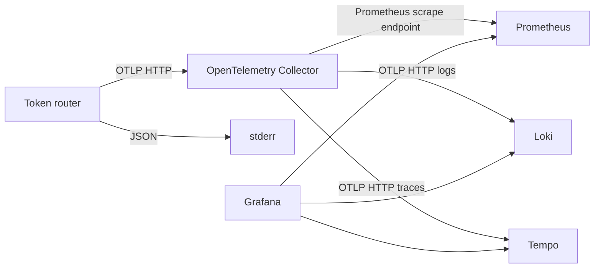

# OpenTelemetry observability

By default, the application writes JSON logs to stderr. With `telemetry.otlp.enabled=true`, selected metrics, logs, and traces are sent to the Collector through OTLP HTTP. The existing `/metrics` Prometheus endpoint is also independently available.

## Collection paths



[`deploy/components`](../../deploy/components/kustomization.yaml) provides Redis and observability components together. See [Deployment components](../development/deployment-components.md) for installation, image versions, port forwarding, and storage lifetimes. Ginkgo uses the same collection configuration in Docker Compose and checks stored data through backend APIs.

## Application configuration

Connect through these environment variables in the same Kubernetes namespace as the Collector:

```yaml
env:
  - name: TOKEN_ROUTER_TELEMETRY_OTLP_ENABLED
    value: "true"
  - name: TOKEN_ROUTER_TELEMETRY_OTLP_ENDPOINT
    value: "http://otel-collector:4318"
  - name: TOKEN_ROUTER_TELEMETRY_SERVICE_NAME
    value: "token-router"
  - name: TOKEN_ROUTER_TELEMETRY_ENVIRONMENT
    value: "development"
  - name: TOKEN_ROUTER_TELEMETRY_LOGS_FORMAT
    value: "json"
```

Apply these environment variables to the proxy process. Installing the Collector and backends alone does not enable proxy export. If you forward the Collector's OTLP HTTP port to `127.0.0.1:14318` for a host process, run:

```sh
TOKEN_ROUTER_TELEMETRY_OTLP_ENABLED=true \
TOKEN_ROUTER_TELEMETRY_OTLP_ENDPOINT=http://127.0.0.1:14318 \
  go run ./src/cmd/token-router serve
```

Disable individual signals with `telemetry.traces.enabled`, `telemetry.metrics.enabled`, and `telemetry.logs.enabled`. Disabling metrics also prevents the Prometheus listener from being created; disabling logs also stops local application logging. With `telemetry.otlp.enabled=false`, no OTLP exporters are created, while local `telemetry.logs.level` and `telemetry.logs.format` settings and `telemetry.metrics.prometheus` settings still apply. See [Application configuration](../reference/configuration.md) for detailed defaults and CLI mappings.

## Log and trace correlation

Request completion logs set `msg` to `HTTP request completed` and include `method`, `route`, `status`, and `duration_seconds`. When tracing is enabled and a valid span exists, they also record `trace_id` and `span_id`. OTLP logs carry the same trace context, allowing correlated Loki log and Tempo trace queries.

Incoming W3C `traceparent` and `tracestate` are used to create server spans. Upstream requests are recorded as separate client spans and propagate their context. SSE spans and request duration cover the entire stream. Sampling uses the configured ratio for root traces and follows the parent trace's sampling decision.

Logs, spans, and metric attributes exclude request bodies, API keys, authentication headers, queries, and raw URLs. `route` is a registered path such as `/v1/*`; unknown paths use `unmatched`, and arbitrary HTTP methods use `OTHER`.

## Metrics and resources

| OTLP instrument | Description |
| --- | --- |
| `token_router.http.requests` | Completed requests, with method, route, and status code |
| `token_router.http.request.duration` | Processing duration including SSE, in `s` |
| `token_router.http.requests.in_flight` | Requests currently being processed |
| `token_router.rate_limit.decisions` | Request counts by `allowed`, `denied`, and `error` results |

Resources for all signals include `service.name`, `service.instance.id`, `service.version`, and `deployment.environment.name`. Instance IDs are generated at startup by default and distinguish processes of the same service. The Collector's Prometheus exporter converts names and resource attributes to Prometheus format. The existing `/metrics` Go runtime and process collectors are not replicated through OTLP.

## Shutdown and export failures

After HTTP requests drain, providers shut down and export pending data within `telemetry.shutdown_timeout`. Metrics and traces shut down before logs. Set Docker stop timeouts and Kubernetes `terminationGracePeriodSeconds` longer than the combined HTTP drain and telemetry shutdown time.

Export is asynchronous; temporary Collector failures do not block proxy requests. If export still fails after exporter retries, a local `OTLP export failed; batch was not delivered` log includes the signal name. This error log is not exported through OTLP again. Failed log and span batches are not persisted, and unresolved export errors at process shutdown produce a failure exit code.

See [Ginkgo E2E tests](../development/end-to-end-tests.md) for validation coverage of the proxy and observability components.
