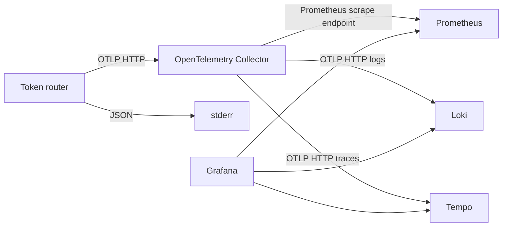

# OpenTelemetry 관측 구성

애플리케이션은 기본적으로 JSON 로그를 stderr에 기록한다. `telemetry.otlp.enabled=true`이면 설정에서 선택한 metrics, logs, traces를 OTLP HTTP로 Collector에 전송한다. 기존 `/metrics` Prometheus 엔드포인트도 독립적으로 사용할 수 있다.

## 수집 경로



[`deploy/components`](../../deploy/components/kustomization.yaml)는 Redis와 관측 컴포넌트를 함께 제공한다. 설치, 이미지 버전, 포트 전달과 저장소 수명은 [배포 컴포넌트](../development/deployment-components.md)에 있다. Ginkgo는 같은 수집 설정을 Docker Compose에서 사용하며 저장된 데이터를 backend API로 확인한다.

## 애플리케이션 설정

Collector와 같은 Kubernetes Namespace에서 다음 환경 변수로 연결한다.

```yaml
env:
  - name: TOKEN_ROUTER_TELEMETRY_OTLP_ENABLED
    value: "true"
  - name: TOKEN_ROUTER_TELEMETRY_OTLP_ENDPOINT
    value: "http://otel-collector:4318"
  - name: TOKEN_ROUTER_TELEMETRY_SERVICE_NAME
    value: "token-router"
  - name: TOKEN_ROUTER_TELEMETRY_ENVIRONMENT
    value: "development"
  - name: TOKEN_ROUTER_TELEMETRY_LOGS_FORMAT
    value: "json"
```

이 환경 변수는 프록시 프로세스에 적용한다. Collector와 backend 컴포넌트를 설치하는 것만으로 프록시의 export가 활성화되지는 않는다. 호스트 프로세스에서 Collector의 OTLP HTTP 포트를 `127.0.0.1:14318`로 전달한 경우에는 다음과 같이 실행한다.

```sh
TOKEN_ROUTER_TELEMETRY_OTLP_ENABLED=true \
TOKEN_ROUTER_TELEMETRY_OTLP_ENDPOINT=http://127.0.0.1:14318 \
  go run ./src/cmd/token-router serve
```

`telemetry.traces.enabled`, `telemetry.metrics.enabled`, `telemetry.logs.enabled`로 각 신호를 끌 수 있다. 메트릭을 끄면 Prometheus 리스너도 생성하지 않고, 로그를 끄면 로컬 애플리케이션 로그도 기록하지 않는다. `telemetry.otlp.enabled=false`이면 OTLP exporter를 만들지 않으며 `telemetry.logs.level`, `telemetry.logs.format`의 로컬 로그 설정과 `telemetry.metrics.prometheus`의 Prometheus 설정은 계속 적용한다. 세부 기본값과 CLI 매핑은 [애플리케이션 설정](../reference/configuration.md)에 있다.

## 로그와 trace 연결

요청 완료 로그의 `msg`는 `HTTP request completed`이며 `method`, `route`, `status`, `duration_seconds`를 포함한다. tracing이 활성화되어 유효한 span이 있으면 `trace_id`, `span_id`를 함께 기록한다. OTLP 로그에도 같은 trace context를 연결하므로 Loki 로그와 Tempo trace를 연결해 조회할 수 있다.

클라이언트의 W3C `traceparent`와 `tracestate`를 읽어 서버 span을 생성한다. upstream 요청은 별도 client span으로 기록하고 그 context를 전달한다. SSE span과 요청 처리 시간은 스트림이 끝날 때까지 유지한다. sampling은 root trace에 설정 비율을 적용하며 부모 trace의 sampling 결정은 따른다.

로그, span과 메트릭 속성에 요청 본문, API key, 인증 헤더, query와 raw URL을 기록하지 않는다. `route`는 `/v1/*` 같은 등록된 경로이며 알 수 없는 경로는 `unmatched`, 임의 HTTP 메서드는 `OTHER`로 기록한다.

## 메트릭과 resource

| OTLP instrument | 내용 |
| --- | --- |
| `token_router.http.requests` | 처리 완료 요청 수, 메서드와 route 및 상태 코드 |
| `token_router.http.request.duration` | SSE를 포함한 처리 시간, 단위 `s` |
| `token_router.http.requests.in_flight` | 현재 처리 중인 요청 수 |
| `token_router.rate_limit.decisions` | `allowed`, `denied`, `error` 결과별 요청 수 |

모든 신호의 resource에는 `service.name`, `service.instance.id`, `service.version`, `deployment.environment.name`이 있다. 인스턴스 ID는 기본적으로 시작할 때 생성하며 같은 서비스의 여러 프로세스를 구분한다. Collector의 Prometheus exporter는 이름과 resource 속성을 Prometheus 형식으로 변환한다. 기존 `/metrics`의 Go runtime과 process collector는 OTLP로 복제하지 않는다.

## 종료와 전송 실패

HTTP 요청을 drain한 다음 `telemetry.shutdown_timeout` 안에서 provider를 종료하고 대기 데이터를 전송한다. metrics와 traces를 종료한 뒤 logs를 종료한다. Docker stop timeout과 Kubernetes `terminationGracePeriodSeconds`는 HTTP drain과 telemetry 종료 시간을 합한 값보다 길게 설정한다.

전송은 비동기이며 Collector의 일시적인 장애 때문에 프록시 요청을 차단하지 않는다. exporter의 재시도 이후에도 전송이 실패하면 `OTLP export failed; batch was not delivered` 로그와 신호 이름을 로컬에 기록한다. 이 오류 로그를 다시 OTLP로 내보내지 않는다. 전송에 실패한 로그와 span 배치를 영구 저장하지 않으며 프로세스 종료 시 미해결 전송 오류는 실패 exit code로 보고한다.

관측 컴포넌트와 프록시의 검증 범위는 [Ginkgo E2E 테스트](../development/end-to-end-tests.md)에 있다.
